# Memoria del Laboratorio — Failover Routing

**Grupo:** 8
**Materia:** Gestión Operativa y Seguridad en Redes (GOYS)
**Fecha de entrega:** viernes 23/10/2026

## Integrantes y roles

| Integrante | Rol |
|-----------|-----|
| **Todos los miembros del grupo** | R1 — Líder / Edge-WAN |
| Jano Stratakis | R2 — Proveedores |
| Ulises Mateo Bucchino | R3 — Core |
| Valentín Garzaniti | R4 — Distribución |
| Sofia Raggi | R5 — Hosts / QA / Operación |

---

## 1.1 Correccion del Diagrama
#### Corrección del diagrama

Diagrama analizado: "Enterprise Network Design (Cisco)", el que vimos en clase. Le encontramos 5 defectos. Esta tabla va en la sección 1.1 de la memoria.

| # | Defecto detectado | Corrección aplicada | Justificación |
|:-:|-------------------|---------------------|---------------|
| 1 | Hay un solo firewall (ASA 5506-X) entre el edge y el core, sin par HA. Es un punto único de falla. | En el lab no hay firewall aparte, el filtrado lo hace EDGE. Dejamos documentado que en una red real tienen que ser dos firewalls en failover (activo/standby). | Los ISR y los ISP están duplicados, pero todo el tráfico pasa por un único ASA. Si se cae, se corta la salida igual y la redundancia de arriba no sirve de nada. En el lab pasa algo parecido con EDGE, que también es uno solo; en producción irían dos. |
| 2 | Subredes repetidas entre sitios: las VLAN 10 y 20 están en el Site 1 y en el Site 2, y la 192.168.10.0/24 aparece dos veces. | Plan de direccionamiento sin solapamientos: cada enlace y cada LAN con su propia red (ver IPAM). | Si la misma red está en dos lugares, al interconectar los sitios el router no sabe a cuál mandar el paquete. OSPF y BGP la anuncian desde dos puntos y el tráfico termina en el sitio equivocado o se pierde. |
| 3 | Entre C1 y C2 (los dos Nexus del core) no hay enlace. | Agregamos el enlace CORE-1 ↔ CORE-2 y corre OSPF área 0 sobre él. | Si se corta EDGE ↔ CORE-1, CORE-1 se queda sin camino directo hacia arriba y el tráfico tiene que bajar a distribución para volver a subir por CORE-2. Con el enlace core-core pasa directo al otro core y OSPF tiene una ruta alternativa corta. |
| 4 | HSRP en el core (VLAN 10, 20 y 30 en los Nexus 9300). Es un diseño "collapsed": el core hace también de gateway de los usuarios. | El gateway pasa a distribución con VRRP entre DIST-1 y DIST-2. El core queda solo para rutear (tránsito puro). | El core tiene que hacer una sola cosa y hacerla rápido. Si además es gateway, un problema de una LAN (ARP, broadcast, cambio de master) termina afectando al equipo del que depende toda la red. En distribución el problema queda en esa capa. Usamos VRRP y no HSRP porque VRRP es estándar (RFC 5798) y HSRP es de Cisco (RFC 2281); en MikroTik no existe HSRP. |
| 5 | El iBGP con route reflector está mal ubicado: la sesión aparece entre las interfaces outside del ASA, atravesando el firewall. | Sin iBGP y sin route reflector. BGP corre solo en EDGE (AS 65000), como eBGP hacia ISP-1 (AS 65001) e ISP-2 (AS 65002). Adentro se usa OSPF. | Un route reflector sirve cuando hay muchos routers iBGP en el mismo AS y no querés hacer full-mesh. Acá hay un solo router de borde, no hay nada que reflejar. Además, si el RR existiera tendría que estar en los routers de borde, no del otro lado del firewall. BGP queda para hablar con los proveedores y OSPF para adentro. |

### Otras cosas que vimos

En el análisis también aparecen problemas que no son de ruteo: no hay QoS para voz, no hay VLAN de gestión y faltan protecciones de capa 2 (port-security, DHCP snooping, DAI, root guard). No los corregimos porque el lab se centra en el failover de ruteo (VRRP, OSPF y BGP), pero los anotamos.

### Topología corregida

Así queda la red después de aplicar las correcciones. Las direcciones IP no van acá, están en el IPAM.

```
[ INTERNET ]        ISP-1 (AS 65001)               ISP-2 (AS 65002)
                           \                             /
                            \ eBGP                 eBGP /
                             \                         /
[ EDGE ]                        EDGE (AS 65000)
                        eBGP x2 + OSPF + filtrado de borde        <- correcciones 1 y 5
                             /                         \
                            / OSPF                OSPF  \
                           /                             \
[ CORE ]               CORE-1 ------- core-core ------- CORE-2    <- corrección 3
                         |    \                       /    |
                         |     \                     /     |
                         |      \___________________/      |
                         |       ___________________       |
                         |      /                   \      |
                         |     /                     \     |
[ DISTRIBUTION ]       DIST-1                         DIST-2      <- corrección 4
                   VRRP 10 master                 VRRP 10 backup
                   VRRP 20 backup                 VRRP 20 master
                         |     \                     /     |
                         |      \___________________/      |
                         |       ___________________       |
                         |      /                   \      |
                         |     /                     \     |
[ ACCESS ]         SW-ACC-USERS                   SW-ACC-SERVERS
                         |                               |
                      PC-USER                        PC-SERVER
```

Las líneas cruzadas son:
- Entre core y distribución: cada DIST está conectado a los dos core (DIST-1 a CORE-2 y DIST-2 a CORE-1).
- Entre distribución y acceso: cada DIST está conectado a los dos switches, porque VRRP necesita que los dos routers estén en la misma LAN.

### Enlaces

| # | Enlace | Capa |
|:-:|--------|------|
| 1 | ISP-1 ↔ EDGE | Internet / Edge |
| 2 | ISP-2 ↔ EDGE | Internet / Edge |
| 3 | EDGE ↔ CORE-1 | Edge / Core |
| 4 | EDGE ↔ CORE-2 | Edge / Core |
| 5 | CORE-1 ↔ CORE-2 | Core (el que faltaba) |
| 6 | CORE-1 ↔ DIST-1 | Core / Distribución |
| 7 | CORE-1 ↔ DIST-2 | Core / Distribución |
| 8 | CORE-2 ↔ DIST-1 | Core / Distribución |
| 9 | CORE-2 ↔ DIST-2 | Core / Distribución |
| 10 | DIST-1 ↔ SW-ACC-USERS | Distribución / Acceso |
| 11 | DIST-2 ↔ SW-ACC-USERS | Distribución / Acceso |
| 12 | DIST-1 ↔ SW-ACC-SERVERS | Distribución / Acceso |
| 13 | DIST-2 ↔ SW-ACC-SERVERS | Distribución / Acceso |
| 14 | SW-ACC-USERS ↔ PC-USER | Acceso |
| 15 | SW-ACC-SERVERS ↔ PC-SERVER | Acceso |

En total son 11 nodos (7 routers, 2 switches y 2 hosts) y 15 enlaces, lo mismo que dice la consigna. En F1 lo comparamos con el proyecto de GNS3.

### Qué cambió con respecto al original

| Original | Corregido |
|----------|-----------|
| Un solo ASA como firewall | Filtrado en EDGE; en producción, dos firewalls en failover |
| Redes repetidas entre sitios | Cada red es única (ver IPAM) |
| C1 y C2 sin enlace entre sí | Enlace CORE-1 ↔ CORE-2 |
| HSRP en el core | VRRP en DIST-1 / DIST-2, el core solo rutea |
| iBGP con route reflector a través del ASA | eBGP solo en EDGE, sin RR, OSPF adentro |
---
## 1.2 IPAM / direccionamiento

### 1.2.1 Criterios definidos

- 7 routers MikroTik CHR.
- 2 switches.
- 2 hosts.
- 15 enlaces.
- AS EDGE: `65000`.
- ISP-1: `65001`.
- ISP-2: `65002`.
- CORE con OSPF área 0.
- CORE-1 Router-ID: `4.4.4.4`.
- CORE-2 Router-ID: `5.5.5.5`.
- VRRP:
  - VRID `10` → USERS → prioridad `150` en DIST-1.
  - VRID `20` → SERVERS → prioridad `150` en DIST-2.
- PC-USER: `192.168.10.100/24`, gateway `192.168.10.1`.
- PC-SERVER: `192.168.20.100/24`, gateway `192.168.20.1`.

### 1.2.2 Criterio de direccionamiento

| Elemento | Criterio |
|---|---|
| Enlaces punto a punto | `/30` |
| LAN USERS | `192.168.10.0/24` |
| LAN SERVERS | `192.168.20.0/24` |
| Loopbacks / Router-ID | `/32` |
| Red de infraestructura | `10.255.0.0/16` |
| VRRP USERS | VRID `10` |
| VRRP SERVERS | VRID `20` |
| Solapamiento de subredes | No permitido |

### 1.2.3 Tabla de direccionamiento de ENLACES

#### Enlaces de Capa 3 con subred `/30`.

| # | Enlace | Subred | Extremo A (IP) | Extremo B (IP) |
|---:|---|---|---|---|
| 1 | ISP-1 ↔ EDGE | `10.255.0.0/30` | ISP-1 (`10.255.0.2`) | EDGE (`10.255.0.1`) |
| 2 | ISP-2 ↔ EDGE | `10.255.0.4/30` | ISP-2 (`10.255.0.6`) | EDGE (`10.255.0.5`) |
| 3 | EDGE ↔ CORE-1 | `10.255.0.8/30` | EDGE (`10.255.0.9`) | CORE-1 (`10.255.0.10`) |
| 4 | EDGE ↔ CORE-2 | `10.255.0.12/30` | EDGE (`10.255.0.13`) | CORE-2 (`10.255.0.14`) |
| 5 | CORE-1 ↔ CORE-2 | `10.255.0.16/30` | CORE-1 (`10.255.0.17`) | CORE-2 (`10.255.0.18`) |
| 6 | CORE-1 ↔ DIST-1 | `10.255.0.20/30` | CORE-1 (`10.255.0.21`) | DIST-1 (`10.255.0.22`) |
| 7 | CORE-1 ↔ DIST-2 | `10.255.0.24/30` | CORE-1 (`10.255.0.25`) | DIST-2 (`10.255.0.26`) |
| 8 | CORE-2 ↔ DIST-1 | `10.255.0.28/30` | CORE-2 (`10.255.0.29`) | DIST-1 (`10.255.0.30`) |
| 9 | CORE-2 ↔ DIST-2 | `10.255.0.32/30` | CORE-2 (`10.255.0.33`) | DIST-2 (`10.255.0.34`) |

#### Enlaces de Capa 2

Los enlaces entre los routers de distribución y los switches de acceso son trunks de Capa 2. Por lo tanto, no se asigna una dirección IP directamente al enlace físico.

| # | Enlace | Tipo | VLAN | IP host | Modo |
|---:|---|---|---|---|---|
| 10 | DIST-1 ↔ SW-ACC-USERS | Trunk L2 | USERS | - | 802.1Q |
| 11 | DIST-2 ↔ SW-ACC-USERS | Trunk L2 | USERS | - | 802.1Q |
| 12 | DIST-1 ↔ SW-ACC-SERVERS | Trunk L2 | SERVERS | - | 802.1Q |
| 13 | DIST-2 ↔ SW-ACC-SERVERS | Trunk L2 | SERVERS | - | 802.1Q |
| 14 | SW-ACC-USERS ↔ PC-USER | Access L2 | USERS | `192.168.10.100/24` | Access |
| 15 | SW-ACC-SERVERS ↔ PC-SERVER | Access L2 | SERVERS | `192.168.20.100/24`| Access | 

#### VLAN y segmentos LAN

| VLAN | Nombre | Subred | Gateway virtual VRRP | Host |
|---:|---|---|---|---|
| 10 | USERS | `192.168.10.0/24` | `192.168.10.1` | PC-USER |
| 20 | SERVERS | `192.168.20.0/24` | `192.168.20.1` | PC-SERVER |

### 1.2.4 LAN USERS

**VLAN:** ` 10 - USERS `
**Red:** `192.168.10.0/24`
**VRID** `10` 

| Dispositivo / función | Dirección |
|---|---|
| Gateway virtual VRRP | `192.168.10.1` |
| DIST-1 | `192.168.10.2` |
| DIST-2 | `192.168.10.3` |
| PC-USER | `192.168.10.100` |
| Máscara | `255.255.255.0` |
| Gateway PC-USER | `192.168.10.1` |

#### VRRP — USERS

| Parámetro | Valor |
|---|---|
| VRID | `10` |
| IP virtual | `192.168.10.1` |
| Master | DIST-1 |
| Priority DIST-1 | `150` |
| Priority DIST-2 | `100` |
| Authentication | VRRP authentication — clave compartida |

Clave autenticacion: definida como secreto compartido entre DIST-1 y DIST-2.

### 1.2.5 LAN SERVERS

**Red:** `192.168.20.0/24`

| Dispositivo / función | Dirección |
|---|---|
| Gateway virtual VRRP | `192.168.20.1` |
| DIST-1 | `192.168.20.2` |
| DIST-2 | `192.168.20.3` |
| PC-SERVER | `192.168.20.100` |
| Máscara | `255.255.255.0` |
| Gateway PC-SERVER | `192.168.20.1` |

#### VRRP — SERVERS

| Parámetro | Valor |
|---|---|
| VRID | `20` |
| IP virtual | `192.168.20.1` |
| Master | DIST-2 |
| Priority DIST-1 | `100` |
| Priority DIST-2 | `150` |
| Authentication | VRRP authentication — clave compartida |

Clave autenticacion: definida como secreto compartido entre DIST-1 y DIST-2.

### 1.2.6 Loopbacks y Router-ID

| Nodo | Rol | Loopback | Router-ID |
|---|---|---|---|
| ISP-1 | Provider | `1.1.1.1/32` | `1.1.1.1` |
| ISP-2 | Provider | `2.2.2.2/32` | `2.2.2.2` |
| EDGE | Edge-WAN | `3.3.3.3/32` | `3.3.3.3` |
| CORE-1 | Core | `4.4.4.4/32` | `4.4.4.4` |
| CORE-2 | Core | `5.5.5.5/32` | `5.5.5.5` |
| DIST-1 | Distribution | `6.6.6.6/32` | `6.6.6.6` |
| DIST-2 | Distribution | `7.7.7.7/32` | `7.7.7.7` |

> Los Router-ID de CORE-1 y CORE-2 están definidos por el diagrama.

### 1.2.7 Resumen de redes
| Uso             | Red/VLAN          | Máscara           | Tipo       |
| --------------- | ----------------- | ----------------- | ---------- |
| ISP-1 ↔ EDGE    | `10.255.0.0/30`   | `255.255.255.252` | L3 P2P     |
| ISP-2 ↔ EDGE    | `10.255.0.4/30`   | `255.255.255.252` | L3 P2P     |
| EDGE ↔ CORE-1   | `10.255.0.8/30`   | `255.255.255.252` | L3 P2P     |
| EDGE ↔ CORE-2   | `10.255.0.12/30`  | `255.255.255.252` | L3 P2P     |
| CORE-1 ↔ CORE-2 | `10.255.0.16/30`  | `255.255.255.252` | L3 P2P     |
| CORE-1 ↔ DIST-1 | `10.255.0.20/30`  | `255.255.255.252` | L3 P2P     |
| CORE-1 ↔ DIST-2 | `10.255.0.24/30`  | `255.255.255.252` | L3 P2P     |
| CORE-2 ↔ DIST-1 | `10.255.0.28/30`  | `255.255.255.252` | L3 P2P     |
| CORE-2 ↔ DIST-2 | `10.255.0.32/30`  | `255.255.255.252` | L3 P2P     |
| VLAN 10 USERS   | `192.168.10.0/24` | `255.255.255.0`   | LAN / VRRP |
| VLAN 20 SERVERS | `192.168.20.0/24` | `255.255.255.0`   | LAN / VRRP |
| Loopbacks       | 7 × `/32`         | `255.255.255.255` | Router-ID  |

### 1.2.8 Verificación de solapamiento

El direccionamiento utiliza bloques separados:

| Bloque | Uso |
|---|---|
| `10.255.0.0/30` – `10.255.0.32/30` | Enlaces L3 |
| `192.168.10.0/24` | VLAN 10 USERS |
| `192.168.20.0/24` | VLAN 20 SERVERS |
| `1.1.1.1/32` – `7.7.7.7/32` | Router-ID / Loopbacks |

No se deben utilizar subredes repetidas entre enlaces, LANs o loopbacks.

Los enlaces L2 no poseen una subred IP propia. Las direcciones IP pertenecen a las VLAN/LAN transportadas por dichos enlaces.

## 1.3 Política de seguridad

Alcance: los **7 routers CHR** (ISP-1, ISP-2, EDGE, CORE-1, CORE-2, DIST-1, DIST-2), RouterOS 7.

Principio rector: **mínimo privilegio y mínima superficie de ataque**. Cada usuario tiene solo los permisos que necesita, cada servicio que no se usa se apaga, y todo protocolo de control (OSPF, BGP, VRRP) se autentica para que ningún equipo no autorizado pueda inyectar rutas o tomar el gateway.

### 1.3.1 Usuarios y privilegios

| Usuario | Grupo | Permisos | Uso |
|---------|-------|----------|-----|
| `admin` | `full` | Total | Configuración. Password obligatoria, distinta de la de fábrica (vacía) |
| `monitor` | `monitor` (custom) | Solo lectura: `read`, `test`, `ssh`, `winbox` | Consultas de estado, verificación de drills, monitoreo |

Reglas:

- **Password de `admin`**: mínimo 12 caracteres. CHR viene con `admin` sin password, por eso es lo primero que se configura al levantar cada router.
- **`monitor` no puede** escribir config, reiniciar, cambiar passwords, ver datos sensibles (`!sensitive`) ni usar `ftp`, `telnet`, `web`, `api` o `sniff`.
- No se crean más usuarios con grupo `full`.

```routeros
/user set admin password=<ADMIN_PASS>
/user group add name=monitor policy=read,test,ssh,winbox,!local,!telnet,!ftp,!reboot,!write,!policy,!password,!web,!sniff,!sensitive,!api,!romon,!rest-api
/user add name=monitor group=monitor password=<MONITOR_PASS>
```

### 1.3.2 Servicios a deshabilitar

#### 1.3.2.1 Servicios de gestión (`/ip service`)

| Servicio | Puerto | Decisión | Motivo |
|----------|:------:|:--------:|--------|
| telnet | 23 | Apagar | Texto plano, credenciales visibles en la red |
| ftp | 21 | Apagar | Texto plano; no se usa |
| www | 80 | Apagar | WebFig sin cifrar; no se usa |
| www-ssl | 443 | Apagar | No se usa |
| api | 8728 | Apagar | No se usa |
| api-ssl | 8729 | Apagar | No se usa |
| ssh | 22 | Mantener | Gestión cifrada |
| winbox | 8291 | Mantener | Gestión GUI |

SSH y Winbox se restringen a redes internas en F3, con el firewall del EDGE.

```routeros
/ip service disable telnet,ftp,www,www-ssl,api,api-ssl
/ip ssh set strong-crypto=yes
```

#### 1.3.2.2 Otros servicios y descubrimiento

| Servicio | Decisión | Motivo |
|----------|:--------:|--------|
| Neighbor discovery (MNDP/CDP/LLDP) | Apagar | Revela identidad, modelo y versión a cualquier vecino |
| MAC-Telnet / MAC-Winbox | Apagar | Acceso de capa 2 que no pasa por el firewall IP |
| Bandwidth test server | Apagar | Se puede usar para saturar el router |
| DNS remoto | Apagar | Evita que el router sea resolver abierto |
| Proxy / SOCKS / UPnP | Apagar | No se usan |
| IP Cloud (DDNS) | Apagar | No se usa; hace conexiones salientes |
| SNMP | Apagado hasta F4 | Se habilita en F4 para monitoreo, solo lectura y con community propia (no `public`) |

```routeros
/ip neighbor discovery-settings set discover-interface-list=none
/tool mac-server set allowed-interface-list=none
/tool mac-server mac-winbox set allowed-interface-list=none
/tool bandwidth-server set enabled=no
/ip dns set allow-remote-requests=no
/ip proxy set enabled=no
/ip socks set enabled=no
/ip upnp set enabled=no
/ip cloud set ddns-enabled=no update-time=no
```

> ⚠️ Si alguien gestiona por **Winbox vía MAC** dentro de GNS3, apagar MAC-Winbox lo deja afuera. Conectarse por IP (Winbox o SSH) o por la consola de GNS3, que no se ve afectada.

### 1.3.3 Claves de autenticación del plano de control

#### 1.3.3.1 Resumen

| Protocolo | Mecanismo | Dónde | Alcance de la clave | Responsable |
|-----------|-----------|-------|---------------------|-------------|
| OSPF | MD5 (key-id 1) | EDGE, CORE-1, CORE-2, DIST-1, DIST-2 | Una clave para todo el área 0 | R3 (con R1 y R4) |
| BGP | TCP-MD5 (RFC 2385) | EDGE ↔ ISP-1, EDGE ↔ ISP-2 | Una clave **distinta por sesión** | R1 + R2 |
| VRRP | Simple (VRRPv2) | DIST-1 ↔ DIST-2 | Una clave **por grupo** (vrid 10 y vrid 20) | R4 |

Criterio:

- **OSPF**: una sola clave en el área es suficiente porque todos los routers pertenecen al mismo dominio administrativo.
- **BGP**: cada sesión es una relación con otra organización (cada ISP). Si la clave de un proveedor se filtra, la sesión con el otro sigue protegida.
- **VRRP**: una clave por grupo, para que un error de configuración en un grupo no afecte al otro.

#### 1.3.3.2 Convención de claves

| Clave | Identificador | Requisito |
|-------|---------------|-----------|
| `<OSPF_KEY>` | OSPF área 0 | Hasta 16 caracteres (límite de MD5 en OSPF) |
| `<BGP_KEY_ISP1>` | Sesión EDGE ↔ ISP-1 | ≥ 12 caracteres |
| `<BGP_KEY_ISP2>` | Sesión EDGE ↔ ISP-2 | ≥ 12 caracteres, distinta de la de ISP-1 |
| `<VRRP_KEY_10>` | VRRP vrid 10 (USERS) | **Máximo 8 caracteres** (límite de VRRPv2) |
| `<VRRP_KEY_20>` | VRRP vrid 20 (SERVERS) | Máximo 8 caracteres |

**Las claves reales no se commitean al repo.** En los `.rsc` y en la memoria se usan los placeholders de la tabla. Las claves reales se comparten por un canal privado del grupo y se le pasan al docente si las pide.

#### 1.3.3.3 Configuración de referencia

**OSPF MD5:** se aplica en el interface-template de cada router OSPF.

```routeros
/routing ospf interface-template set [find] auth=md5 auth-id=1 auth-key=<OSPF_KEY>
```

**BGP TCP-MD5:** en EDGE y en el ISP correspondiente, con la misma clave en ambos extremos.

```routeros
# EDGE
/routing bgp connection set [find name=to-isp1] tcp-md5-key=<BGP_KEY_ISP1>
/routing bgp connection set [find name=to-isp2] tcp-md5-key=<BGP_KEY_ISP2>
```

**VRRP auth:** en DIST-1 y DIST-2.

```routeros
/interface vrrp set [find vrid=10] version=2 authentication=simple password=<VRRP_KEY_10>
/interface vrrp set [find vrid=20] version=2 authentication=simple password=<VRRP_KEY_20>
```

> ⚠️ **VRRPv3 (RFC 5798), que es el default de RouterOS 7, no soporta autenticación.** El RFC la eliminó porque una clave simple viaja en texto plano y no aporta seguridad real. Para cumplir la consigna se usa **VRRPv2 (RFC 3768) con auth simple**. Conviene saberlo para la defensa: la auth simple de VRRP evita errores de configuración (un router mal configurado que se suma al grupo), pero no frena a un atacante que capture el tráfico.

### 1.3.4 Relación con backups

- `/export` en RouterOS 7 **oculta los datos sensibles por defecto**: passwords y claves no aparecen. Por eso los `/export` del directorio `backups/` se pueden versionar sin filtrar claves.
- Al restaurar desde un `/export` hay que **volver a cargar las claves** a mano.
- Los archivos binarios de `/system backup save` sí contienen las claves. Se generan **siempre con password** (`/system backup save password=<BACKUP_PASS>`) y solo entonces se versionan en `backups/`, según la política de operación (sección 1.4 de la memoria). Un `.backup` sin password no se commitea.
- `<BACKUP_PASS>` sigue la misma regla que las demás claves: no se commitea y se comparte por el canal privado del grupo.

### 1.3.5 Verificación (F1 y F4)

| Control | Cómo se verifica | Resultado esperado |
|---------|------------------|--------------------|
| Password admin | Login sin password | Rechazado |
| Usuario `monitor` | Login como `monitor` + `/system identity set name=x` | Lee config, **no** puede escribir |
| Servicios | `/ip service print` | Solo `ssh` y `winbox` habilitados |
| OSPF MD5 | Cambiar `auth-key` en un vecino | Adyacencia cae (no llega a FULL) |
| BGP TCP-MD5 | Cambiar `tcp-md5-key` en un extremo | Sesión no llega a established |
| VRRP auth | Cambiar `password` en DIST-2 | Los dos routers no se reconocen: ambos pasan a master (comportamiento a documentar) |

Las tres últimas son la **prueba obligatoria de clave incorrecta** del Epic F4 y se documentan con captura en la sección 5 de la memoria.

---

## 1.4 Política de operación

- **Formato del change log** (convención de commits): 
  se utilizará la convención "Conventional Commits" para el repositorio con la estructura: `tipo(alcance): descripción breve`. Los tipos permitidos estrictamente son: `feat` (nueva config/feature), `fix` (correcciones), `docs` (memoria/runbooks), `ops` (backups/change log), y `chore` (mantenimiento estructural). 
  Asimismo, en la sección 6.1 de esta memoria, el Change Log reflejará las intervenciones en los nodos detallando: Fecha, Rol responsable, Cambio realizado (nodo afectado y descripción), Motivo del cambio (commit asociado) y Cómo se revierte (procedimiento de rollback).

- **Política de backup** (cuándo y cómo): 
  - **Cuándo:** se tomará un backup inicial (Snapshot BASE) de todos los equipos en la Fase 1. Posteriormente, se realizarán backups al finalizar cada hito o antes de aplicar un cambio crítico.
  - **Qué y Cómo:** para cada router MikroTik CHR, se extraerá la configuración ejecutando los comandos `/export` (para tener la configuración legible) y `/system backup save` (para el binario completo).
  - **Dónde:** estos archivos serán versionados por fecha y almacenados en el repositorio del grupo dentro de la carpeta `backups/`.
  - **Restauración:** se documentará evidencia probando el *restore* del archivo `.backup` en un nodo para garantizar que la recuperación sea viable ante incidentes.

## 2. Topologia
### 2.1 Despliegue
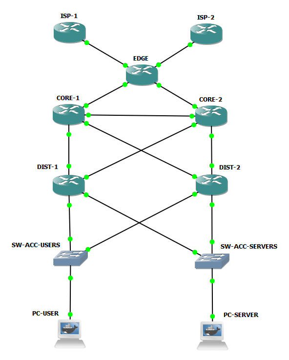

Se realizó el despliegue de la infraestructura definida durante la parte F0 en el entorno GNS3. La topología está compuesta por **siete routers MikroTik CHR** correspondientes a ISP-1, ISP-2, EDGE, CORE-1, CORE-2, DIST-1 y DIST-2, **dos switches de acceso** y **dos hosts finales**, totalizando **11 nodos y 15 enlaces**.

Los routers ISP-1 e ISP-2 representan los proveedores externos, mientras que EDGE implementa posteriormente la función de multi-homing. CORE-1 y CORE-2 conforman la capa de Core, con un enlace directo entre ambos. DIST-1 y DIST-2 conforman la capa de Distribution y se encuentran conectados redundantemente con ambos routers Core y con los switches de acceso.

En la capa Access se desplegaron SW-ACC-USERS y SW-ACC-SERVERS, conectados respectivamente con PC-USER y SRV. Los hosts fueron preparados con las direcciones `192.168.10.100/24` y `192.168.20.100/24`, respectivamente, utilizando como gateways virtuales las direcciones `192.168.10.1` y `192.168.20.1`.

### 2.2 IPs de enlace + Loopbacks

Se realizo la configuracion de las direcciones IP correspondientes a los enlaces punto a punto, interfaces LAN/VLAN y loopbacks de los routers que forman parte de la arquitectura.

Las direcciones utilizadas fueron definidas mediante subredes `/30` para los enlaces punto a punto, mientras que las redes de usuarios y servidores se implementaron mediante las VLAN correspondientes.

| Dispositivo | Interfaz / Enlace | Dirección IP | Máscara | Función |
|-------------|-------------------|--------------|---------|---------|
| **ISP-1** | Enlace ISP-1 ↔ EDGE | `10.255.0.2/30` | `/30` | Enlace WAN |
| **ISP-1** | Loopback | `1.1.1.1/32` | `/32` | Router-ID / identificación estable |
| **ISP-2** | Enlace ISP-2 ↔ EDGE | `10.255.0.6/30` | `/30` | Enlace WAN |
| **ISP-2** | Loopback | `2.2.2.2/32` | `/32` | Router-ID / identificación estable |
| **EDGE** | Enlace EDGE ↔ ISP-1 | `10.255.0.1/30` | `/30` | Enlace WAN |
| **EDGE** | Enlace EDGE ↔ ISP-2 | `10.255.0.5/30` | `/30` | Enlace WAN |
| **EDGE** | Enlace EDGE ↔ CORE-1 | `10.255.0.9/30` | `/30` | Enlace interno |
| **EDGE** | Enlace EDGE ↔ CORE-2 | `10.255.0.13/30` | `/30` | Enlace interno |
| **EDGE** | Loopback | `3.3.3.3/32` | `/32` | Router-ID / identificación estable |
| **CORE-1** | Enlace CORE-1 ↔ EDGE | `10.255.0.10/30` | `/30` | Enlace interno |
| **CORE-1** | Enlace CORE-1 ↔ CORE-2 | `10.255.0.17/30` | `/30` | Enlace Core-Core |
| **CORE-1** | Enlace CORE-1 ↔ DIST-1 | `10.255.0.21/30` | `/30` | Enlace hacia Distribution |
| **CORE-1** | Enlace CORE-1 ↔ DIST-2 | `10.255.0.25/30` | `/30` | Enlace hacia Distribution |
| **CORE-1** | Loopback | `4.4.4.4/32` | `/32` | Router-ID OSPF |
| **CORE-2** | Enlace CORE-2 ↔ EDGE | `10.255.0.14/30` | `/30` | Enlace interno |
| **CORE-2** | Enlace CORE-2 ↔ CORE-1 | `10.255.0.18/30` | `/30` | Enlace Core-Core |
| **CORE-2** | Enlace CORE-2 ↔ DIST-1 | `10.255.0.29/30` | `/30` | Enlace hacia Distribution |
| **CORE-2** | Enlace CORE-2 ↔ DIST-2 | `10.255.0.33/30` | `/30` | Enlace hacia Distribution |
| **CORE-2** | Loopback | `5.5.5.5/32` | `/32` | Router-ID OSPF |
| **DIST-1** | Enlace DIST-1 ↔ CORE-1 | `10.255.0.22/30` | `/30` | Enlace hacia Core |
| **DIST-1** | Enlace DIST-1 ↔ CORE-2 | `10.255.0.30/30` | `/30` | Enlace hacia Core |
| **DIST-1** | VLAN USERS | `192.168.10.2/24` | `/24` | Gateway físico de USERS |
| **DIST-1** | VLAN SERVERS | `192.168.20.2/24` | `/24` | Gateway físico de SERVERS |
| **DIST-1** | Loopback | `6.6.6.6/32` | `/32` | Router-ID / identificación estable |
| **DIST-2** | Enlace DIST-2 ↔ CORE-1 | `10.255.0.26/30` | `/30` | Enlace hacia Core |
| **DIST-2** | Enlace DIST-2 ↔ CORE-2 | `10.255.0.34/30` | `/30` | Enlace hacia Core |
| **DIST-2** | VLAN USERS | `192.168.10.3/24` | `/24` | Gateway físico de USERS |
| **DIST-2** | VLAN SERVERS | `192.168.20.3/24` | `/24` | Gateway físico de SERVERS |
| **DIST-2** | Loopback | `7.7.7.7/32` | `/32` | Router-ID / identificación estable |

#### 2.2.1 Configuracion de CORE1
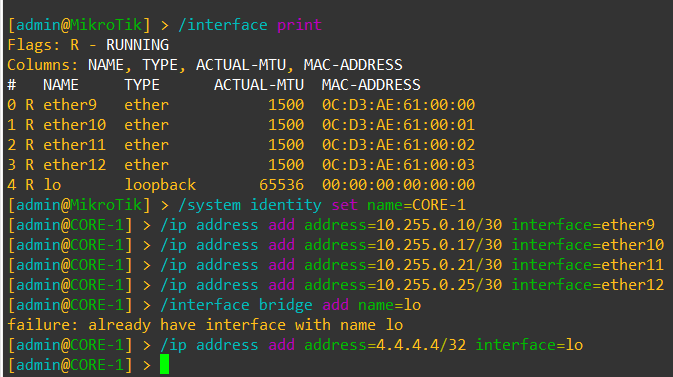

#### 2.2.2 Configuracion de CORE2
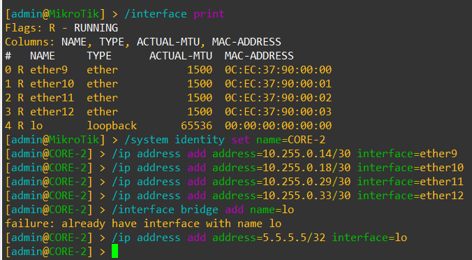

#### 2.2.3 Configuracion de DIST1
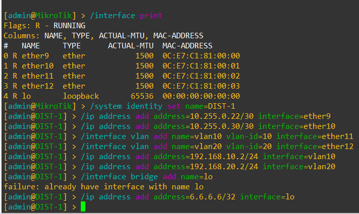

#### 2.2.4 Configuracion de DIST2
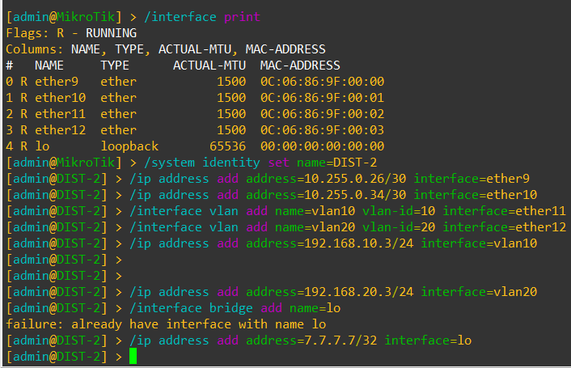

#### 2.2.5 Configuracion de EDGE
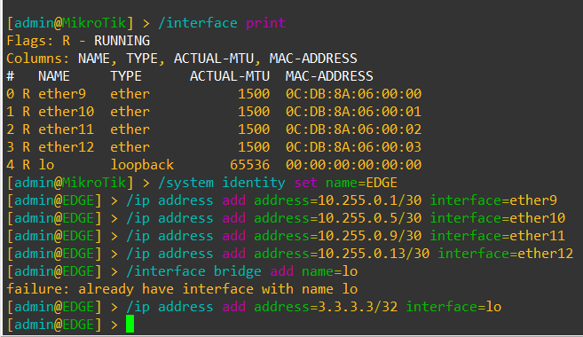

#### 2.2.6 Configuracion de ISP1
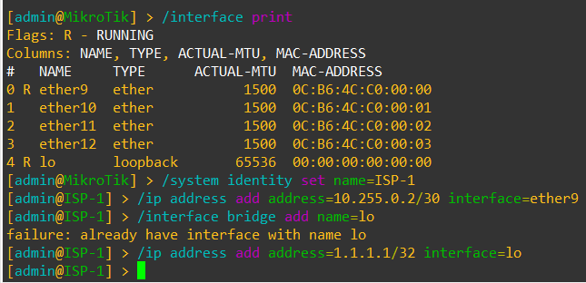

#### 2.2.7 Configuracion de ISP2
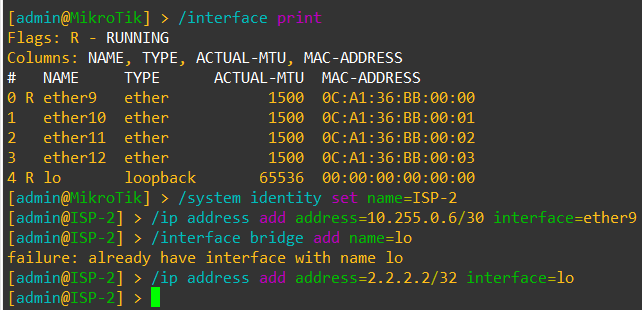

#### 2.2.8 Configuracion de PC-SERVER
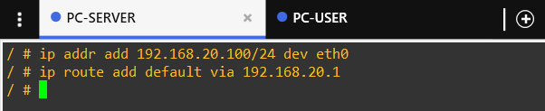

#### 2.2.9 Configuracion de PC-USER
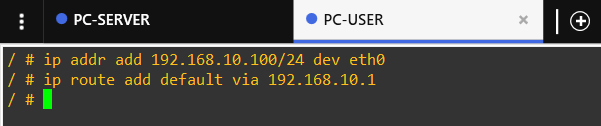

#### 2.2.10 Verificación de conectividad entre vecinos directos

Una vez finalizada la configuración de las direcciones IP de los enlaces punto a punto, las interfaces LAN y las loopbacks, se realizaron pruebas de conectividad mediante el comando ping. Con el objetivo de comprobar que los dispositivos conectados directamente pudieran comunicarse utilizando las direcciones IP configuradas.

**Registro de pruebas de conectividad**

| ID | Dispositivo de origen | Dispositivo de destino | Objetivo de la prueba | Evidencia |
|---|---|---|---|---|
| PING-01 | DIST2 | CORE1 - CORE2 - PCSERVER - DIST1 | Verificar conectividad desde DIST2. | [Captura de ping desde DIST2](/goys-failover-grupo08/capturas/F1/pruebaConectividadCORE1-CORE2-PCSERVER-DIST1DesdeDIST2.png) |
| PING-02 |  DIST1 | CORE1 - CORE2 - PCUSER - DIST2 | Verificar conectividad desde DIST1. | [Captura de ping desde DIST1](/goys-failover-grupo08/capturas/F1/pruebaConectividadCORE1-CORE2-PCUSER-DIST2DesdeDIST1.png) |
| PING-03 | PC-USER | DIST1 | Verificar conectividad desde PC-USER. | [Captura de ping desde PC-USER](/goys-failover-grupo08/capturas/F1/pruebaConectividadDIST1DesdePC-USER.png) |
| PING-04 | PC-SERVER | DIST2 | Verificar conectividad desde PC-SERVER. | [Captura de ping desde PC-SERVER](/goys-failover-grupo08/capturas/F1/pruebaConectividadDIST2DesdePC-SERVER.png) |
| PING-05 | CORE2 | EDGE - CORE1 - DIST1 - DIST2 | Verificar conectividad desde CORE2. | [Captura de ping desde CORE2](/goys-failover-grupo08/capturas/F1/pruebaConectividadEDGE-CORE1-DIST1-DIST2DesdeCORE2.png) |
| PING-06 | CORE1 | EDGE - CORE2 - DIST1 - DIST2 | Verificar conectividad desde CORE1. | [Captura de ping desde CORE1](/goys-failover-grupo08/capturas/F1/pruebaConectividadEDGE-CORE2-DIST1-DIST2DesdeCORE1.png) |
| PING-07 | ISP-1 | EDGE | Verificar conectividad desde ISP-1. | [Captura de ping desde ISP-1](/goys-failover-grupo08/capturas/F1/pruebaConectividadEDGEDesdeISP-1.png) |
| PING-08 | ISP-2 | EDGE | Verificar conectividad desde ISP-2. | [Captura de ping desde ISP-2](/goys-failover-grupo08/capturas/F1/pruebaConectividadEDGEDesdeISP-2.png) |
| PING-09 | EDGE | ISP1 - ISP2 - CORE1 - CORE2 | Verificar conectividad desde EDGE. | [Captura de ping desde EDGE](/goys-failover-grupo08/capturas/F1/pruebaConectividadISP1-ISP2-CORE1-CORE2DesdeEDGE.png) |

### 2.3 Hardening

Se realizo el hardening de los 7 routers (ISP-1, ISP-2, EDGE, CORE-1, CORE-2, DIST-1 y DIST-2) segun la politica de seguridad definida en F0 (seccion 1.3).

Se deshabilitaron los servicios que no se utilizan, se dejaron habilitados solo los servicios de gestion y se creo el grupo de solo lectura `monitor`. La configuracion aplicada es la misma en todos los routers y se puede ver en los respaldos de `backups/2026-10-08_F1_BASE/`.

| Medida | Configuración | Función |
|--------|---------------|---------|
| Grupo `monitor` | `policy=ssh,read,test,winbox` | Acceso de solo lectura |
| Servicios deshabilitados | `ftp`, `telnet`, `www`, `www-ssl`, `api`, `api-ssl` | Reducir servicios expuestos |
| Servicios habilitados | `ssh`, `winbox` | Acceso de gestion |
| SSH | `strong-crypto=yes` | Cifrado fuerte en SSH |
| Neighbor discovery | `discover-interface-list=none` | No anunciar el equipo a los vecinos |
| MAC server / MAC winbox | `allowed-interface-list=none` | Sin acceso por direccion MAC |
| Bandwidth server | `enabled=no` | Servicio deshabilitado |

| Dispositivo | Respaldo | Grupo `monitor` | Servicios | SSH | Neighbor discovery | MAC server / MAC winbox | Bandwidth server |
|-------------|----------|:---------------:|:---------:|:---:|:------------------:|:-----------------------:|:----------------:|
| **ISP-1** | `isp1.rsc` | Sí | Sí | Sí | Sí | Sí | Sí |
| **ISP-2** | `isp2.rsc` | Sí | Sí | Sí | Sí | Sí | Sí |
| **EDGE** | `edge.rsc` | Sí | Sí | Sí | Sí | Sí | Sí |
| **CORE-1** | `core1.rsc` | Sí | Sí | Sí | Sí | Sí | Sí |
| **CORE-2** | `core2.rsc` | Sí | Sí | Sí | Sí | Sí | Sí |
| **DIST-1** | `dist1.rsc` | Sí | Sí | Sí | Sí | Sí | Sí |
| **DIST-2** | `dist2.rsc` | Sí | Sí | Sí | Sí | Sí | Sí |

Como la configuracion de servicios es la misma en los 7 routers, se adjunta como evidencia la captura de `/ip service print` tomada en ISP-1.

#### 2.3.1 Hardening de ISP1
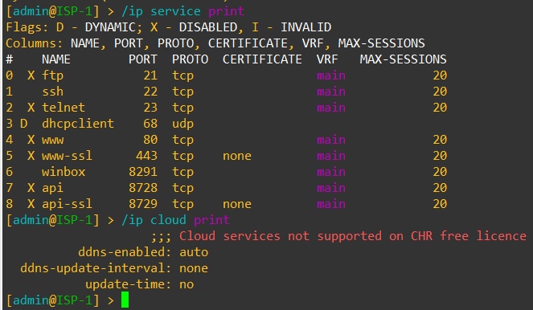

### 2.4 Backup inicial

Se tomó el Snapshot BASE de los 7 routers (ISP-1, ISP-2, EDGE, CORE-1, CORE-2, DIST-1, DIST-2) según la Política de operación (sección 1.4): para cada uno se ejecutó `/export` y se versionó el resultado en el repositorio, en `backups/2026-10-08_F1_BASE/`.

| Router | Archivo |
|--------|---------|
| EDGE | `backups/2026-10-08_F1_BASE/edge.rsc` |
| ISP-1 | `backups/2026-10-08_F1_BASE/isp1.rsc` |
| ISP-2 | `backups/2026-10-08_F1_BASE/isp2.rsc` |
| CORE-1 | `backups/2026-10-08_F1_BASE/core1.rsc` |
| CORE-2 | `backups/2026-10-08_F1_BASE/core2.rsc` |
| DIST-1 | `backups/2026-10-08_F1_BASE/dist1.rsc` |
| DIST-2 | `backups/2026-10-08_F1_BASE/dist2.rsc` |

El commit `ops(backup): agrega respaldos rsc, evidencias de conectividad y hardening F1` registra el backup inicial post-F1 junto con sus evidencias.

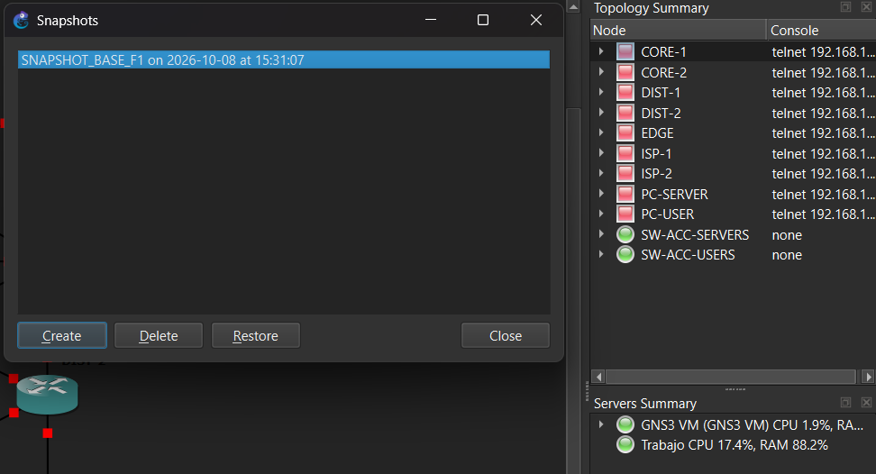
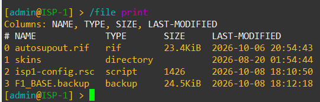


## 3.Configuracion
### 3.1 Desarrollo de VRRP

El objetivo de esta parte corresponde a implementar un mecanismo de redundancia de capa 3 mediante Virtual Router Redundancy Protocol (VRRP) en los routers DIST-1 y DIST-2. 

Esta configuracion nos permite proporcionar gateways virtuales para las redes de usuarios y servidores, manteniendo asi la disponibilidad del servicio ante la pérdida del router, el cual desempeña el rol principal.

Adicionalmente, tambien se busco distribuir el rol de Master entre ambos routers para asi implementar un esquema de load-sharing, evitando que un único dispositivo asumiera permanentemente la responsabilidad principal sobre ambas redes.

#### 3.1.1 Configuracion de los grupos VRRP

Se configuraron dos grupos VRRP, identificados mediante los valores VRID 10 y VRID 20. Cada grupo nos proporciona una dirección IP virtual que los equipos finales utilizan como gateway predeterminado.

La distribución de los roles se estableció de la siguiente manera:

| Grupo VRRP | Red asociada | Gateway virtual | Router Master | Router Backup |
|---|---|---|---|---|
| VRID 10 | LAN de usuarios | 192.168.10.1 | DIST-1 | DIST-2 |
| VRID 20 | LAN de servidores | 192.168.20.1 | DIST-2 | DIST-1 |

Para determinar que router asumiria el rol de Master en cada grupo, se decidio por desarrollar prioridades diferenciadas al momento de decidir.

- DIST-1 recibio un prioridad superior en el grupo VRID 10
- DIST-2 recibio un prioridad superior en el grupo VRID 20

De esta forma, ambos routers participan en la provisión de los gateways virtuales y mantienen una función de respaldo para la otra red. Si surge el caso de que el router Master de un grupo deja de estar disponible, el router Backup puede asumir ese rol, sujeto a las condiciones de funcionamiento de VRRP y a la conectividad del entorno.

#### 3.1.2 Verificación del estado operativo de VRRP

Una vez que finalizo la configuracion, se verifico el estado de las interfaces VRRP en ambos routers mediante los comandos de consulta de RouterOS. En donde, se comprobó que la distribución de roles coincidiera con el esquema previsto para el laboratorio.

En donde se espera que DIST-1 se encuentre en estado Master para VRID 10 y Backup para el VRID 20, mientras que DIST-2 presente la distribucion inversa.

*Evidencia de configuración en DIST-1*

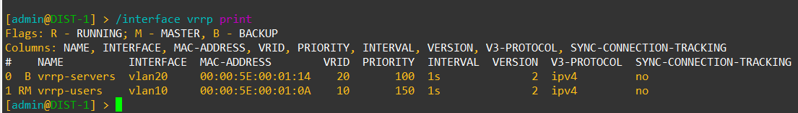

*Evidencia de configuración en DIST-2*

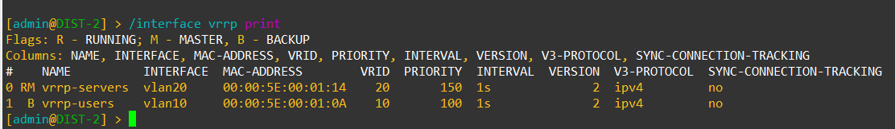

#### 3.1.3 Resultado de la implementacion 
Con la configuración de VRRP se establecen dos gateways virtuales redundantes para las LAN de usuarios y servidores. La distribución de los roles Master entre DIST-1 y DIST-2 nos permite implementar el esquema de load-sharing definido para la fase, mientras que la presencia de un router Backup en cada grupo tambien nos proporciona la capacidad de asumir el gateway ante una falla del Master.

Gracias a esta implementación se establece la base de redundancia de capa 3 requerida para continuar con las verificaciones de conectividad y con la integración del enrutamiento dinámico mediante OSPF, correspondiente a las siguientes actividades de la Fase 2.

### 3.2 Desarrollo de OSPF área 0

El objetivo de esta parte es implementar enrutamiento dinámico mediante OSPF en un único dominio (área 0, backbone) que abarque a EDGE, CORE-1, CORE-2, DIST-1 y DIST-2, de modo que cada router aprenda las loopbacks, los enlaces punto a punto y las LAN de usuarios y servidores sin rutas estáticas. Los routers ISP-1 e ISP-2 quedan fuera de OSPF: se conectan con EDGE por eBGP (Fase 3).

Con OSPF también se aprovecha la redundancia de la topología: cada router de distribución llega a EDGE por dos caminos (vía CORE-1 y vía CORE-2), y el enlace directo CORE-1 ↔ CORE-2 forma parte del área.

#### 3.2.1 Configuración de OSPF

En los cinco routers se creó la misma estructura de RouterOS 7: una instancia (`ospf-instance-1`), el área `backbone-area` (área 0) y un `interface-template` que activa OSPF en las interfaces indicadas.

| Router | Router-ID | Interfaces en OSPF | Vecinos esperados |
|---|---|---|---|
| EDGE | `3.3.3.3` | `ether11`, `ether12`, `lo` | CORE-1, CORE-2 |
| CORE-1 | `4.4.4.4` | `ether9`, `ether10`, `ether11`, `ether12`, `lo` | EDGE, CORE-2, DIST-1, DIST-2 |
| CORE-2 | `5.5.5.5` | `ether9`, `ether10`, `ether11`, `ether12`, `lo` | EDGE, CORE-1, DIST-1, DIST-2 |
| DIST-1 | `6.6.6.6` | `ether9`, `ether10`, `vlan10`, `vlan20`, `lo` | CORE-1, CORE-2 (y DIST-2 por las VLAN) |
| DIST-2 | `7.7.7.7` | `ether9`, `ether10`, `vlan10`, `vlan20`, `lo` | CORE-1, CORE-2 (y DIST-1 por las VLAN) |

Los Router-ID coinciden con las loopbacks definidas en el IPAM (sección 1.2.6). EDGE no anuncia en OSPF sus enlaces hacia los ISP (`ether9` y `ether10`): esos enlaces pertenecen a la frontera con BGP.

Además, en EDGE la instancia OSPF se configuró con `originate-default=always`, de modo que el resto del dominio reciba una ruta por defecto desde EDGE. Esto se completa en la Fase 3 con la salida hacia los ISP.

*Evidencia de configuración*

| Router | Captura |
|---|---|
| EDGE | 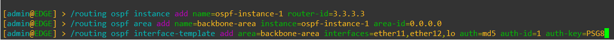 |
| CORE-1 | 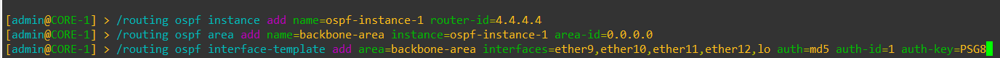 |
| CORE-2 | 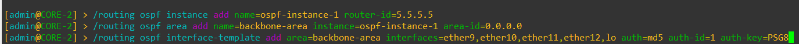 |
| DIST-1 | 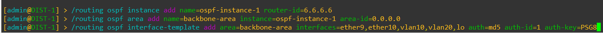 |
| DIST-2 | 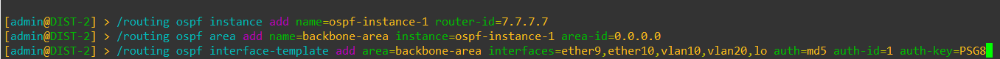 |

#### 3.2.2 Autenticación MD5

Según la política de seguridad (sección 1.3.3), todas las interfaces OSPF usan autenticación MD5 con `auth-id=1` y una única clave `<OSPF_KEY>` para toda el área 0. La clave se aplica en el `interface-template` de cada router:

```routeros
/routing ospf interface-template
add area=backbone-area auth=md5 auth-id=1 interfaces=<interfaces del router>
```

En los respaldos (`backups/2026-10-11_F2_BASE/`) se ve `auth=md5 auth-id=1` en los cinco routers. La clave en sí no figura, porque `/export` oculta los datos sensibles. Que todas las adyacencias lleguen a `Full` confirma que la clave es la misma en todo el área: un router con otra clave no formaría la adyacencia. La prueba explícita con clave incorrecta corresponde a la Fase 4.

#### 3.2.3 Verificación de adyacencias

Se ejecutó `/routing ospf neighbor print` en cada router. Todas las adyacencias están en estado `Full`.

| Router | Vecinos en `Full` | Interfaz |
|---|---|---|
| EDGE | CORE-1 (`4.4.4.4`) | `ether11` |
| | CORE-2 (`5.5.5.5`) | `ether12` |
| CORE-1 | EDGE (`3.3.3.3`) | `ether9` |
| | CORE-2 (`5.5.5.5`) | `ether10` |
| | DIST-1 (`6.6.6.6`) | `ether11` |
| | DIST-2 (`7.7.7.7`) | `ether12` |
| CORE-2 | EDGE (`3.3.3.3`) | `ether9` |
| | CORE-1 (`4.4.4.4`) | `ether10` |
| | DIST-1 (`6.6.6.6`) | `ether11` |
| | DIST-2 (`7.7.7.7`) | `ether12` |
| DIST-1 | CORE-1 (`4.4.4.4`) | `ether9` |
| | CORE-2 (`5.5.5.5`) | `ether10` |
| | DIST-2 (`7.7.7.7`) | `vlan10` y `vlan20` |
| DIST-2 | CORE-1 (`4.4.4.4`) | `ether9` |
| | CORE-2 (`5.5.5.5`) | `ether10` |
| | DIST-1 (`6.6.6.6`) | `vlan10` y `vlan20` |

La adyacencia `CORE-1 ↔ CORE-2` (`ether10` en ambos) cumple el requisito del enlace core–core dentro del área. DIST-1 y DIST-2 también se vuelven vecinos entre sí a través de las VLAN 10 y 20, porque esas interfaces participan en OSPF y los dos routers comparten esos segmentos.

*Evidencia: `/routing ospf neighbor print`*

| Router | Captura |
|---|---|
| EDGE | 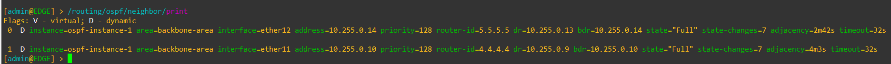 |
| CORE-1 | 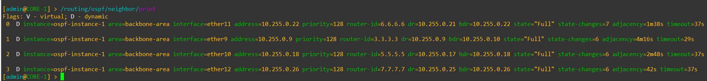 |
| CORE-2 | 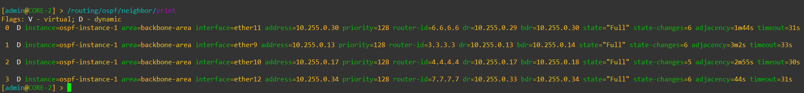 |
| DIST-1 | 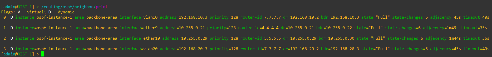 |
| DIST-2 | 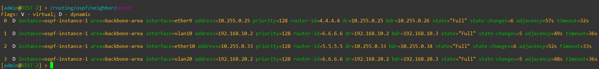 |

#### 3.2.4 Verificación de la tabla de ruteo

Se consultaron las rutas aprendidas por OSPF con `/ip route print where ospf`. En EDGE se observan las loopbacks de CORE-1, CORE-2, DIST-1 y DIST-2, los enlaces core–core y dist–core y las LAN `192.168.10.0/24` y `192.168.20.0/24`, todas con distancia administrativa `110`.

Las LAN y las loopbacks de distribución aparecen **dos veces**, una por `ether11` (vía CORE-1, gateway `10.255.0.10`) y otra por `ether12` (vía CORE-2, gateway `10.255.0.14`). Ambas están activas con la marca `+` de ECMP, es decir que EDGE reparte el tráfico entre los dos routers de core y conserva una ruta si el otro falla. Es la redundancia que se va a poner a prueba en los drills de la Fase 4.

*Evidencia: tablas de ruteo*

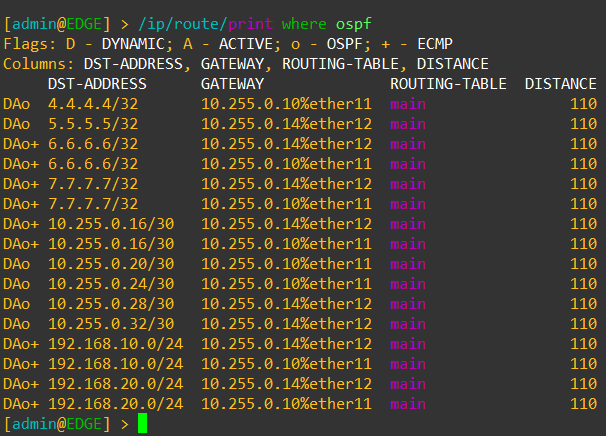
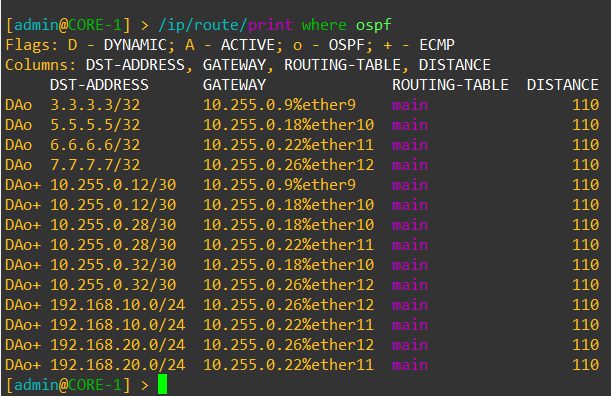
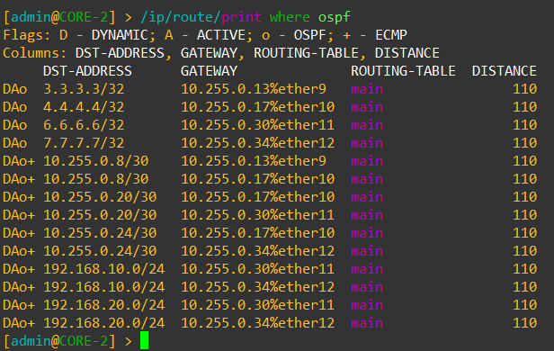

#### 3.2.5 Resultado de la implementación

OSPF área 0 quedó operativo en los cinco routers, con adyacencias `Full` en todos los enlaces, incluido el enlace core–core, y con autenticación MD5 activa. Cada router conoce los prefijos del resto del dominio y EDGE dispone de caminos redundantes hacia las LAN a través de ambos routers de core.

Con esto se habilita la verificación de conectividad de capa 3 entre hosts y la integración con BGP en EDGE, correspondientes a las actividades siguientes de las Fases 2 y 3.

Observación para la revisión: las interfaces `vlan10` y `vlan20` de DIST-1 y DIST-2 están en OSPF como interfaces activas, por eso los dos routers forman una adyacencia entre sí por las LAN. No afecta el funcionamiento, pero se podría reducir con `passive=yes` en esas interfaces si se prefiere que las LAN solo se anuncien y no formen vecindades.

### 3.3 Verificación L3

El objetivo de esta parte corresponde a comprobar la conectividad de capa 3 una vez configurados VRRP y OSPF. Para ello se verifico que los hosts alcancen su gateway virtual y que exista comunicacion entre las dos LAN.

#### 3.3.1 Ping al gateway virtual

Desde cada host se ejecuto `ping` hacia la direccion IP virtual de su grupo VRRP, que es el gateway configurado en el equipo.

| Origen | Destino | Gateway virtual de | Resultado |
|---|---|---|---|
| PC-USER (`192.168.10.100`) | `192.168.10.1` | VRID 10 (USERS) | 3 enviados, 3 recibidos, 0 % de pérdida, TTL 64 |
| PC-SERVER (`192.168.20.100`) | `192.168.20.1` | VRID 20 (SERVERS) | 3 enviados, 3 recibidos, 0 % de pérdida, TTL 64 |

En ambos casos el gateway virtual responde, por lo que los hosts tienen salida hacia el router Master de su grupo.

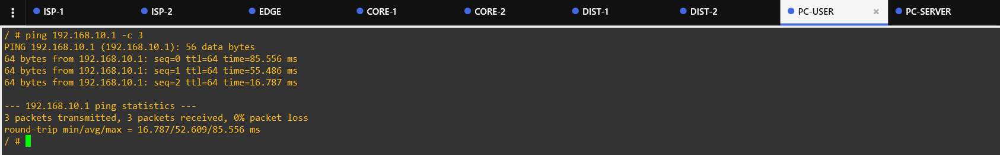

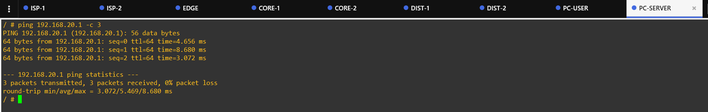

#### 3.3.2 Ping entre hosts de distintas LAN

Luego se comprobo la comunicacion entre las dos redes, ejecutando `ping` desde PC-USER hacia PC-SERVER.

| Origen | Destino | Resultado |
|---|---|---|
| PC-USER (`192.168.10.100`) | PC-SERVER (`192.168.20.100`) | 3 enviados, 3 recibidos, 0 % de pérdida, TTL 63 |

El TTL de 63 corresponde a un salto de router desde el valor inicial de 64, ya que el trafico pasa de la LAN de usuarios a la de servidores a traves de la capa de distribucion.

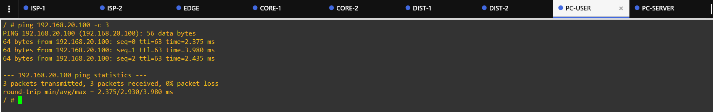

#### 3.3.3 Resultado de la verificación

El criterio de aceptación se cumple: los dos hosts alcanzan su gateway virtual y existe conectividad entre las LAN de usuarios y servidores. Con esto queda comprobado el funcionamiento conjunto de VRRP y OSPF definido para la Fase 2.

## 4. Implementacion de BGP + firewall
### 4.1 eBGP Multi-homing
El objetivo de esta etapa corresponde a implementar conectividad mediante el protocolo eBGP entre el router EDGE y los dos proveedores de servicios de internet, ISP-1 e ISP-2

Esta configuracion nos permite que EDGE establezca sesiones BGP independientes con ambos proveedores, proporcionando asi una arquitectura con multiples conexiones externas. Asimismo, tambien nos permite preparar la infraestructura para anunciar las redes internas hacia los ISP y disponer de información de enrutamiento intercambiada mediante BGP.

#### 4.1.1 Configuracion de eBGP en EDGE
Para comenzar, en el router EDGE se configuraron las conexiones BGP correspondientes a ISP-1 e ISP-2. Para ello, se definieron los parámetros necesarios para identificar cada vecino.

Ademas, tambien se configuro la autenticacion TCP-MD5 para proteger el establecimiento de las sesiones BGP mediante una clave compartida entre cada par de vecinos.

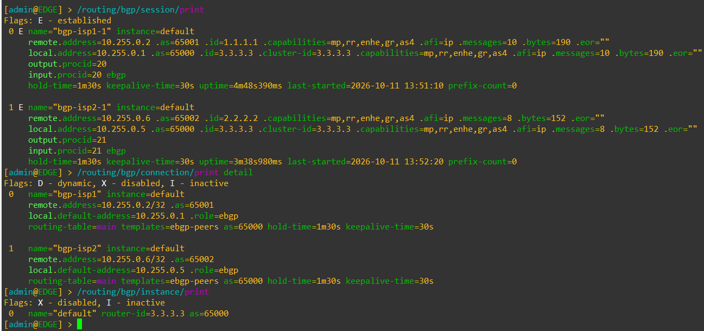

#### 4.1.2 Configuración de eBGP en ISP-1 e ISP-2
Seguido de esto, en los routers ISP-1 e ISP-2 se configuraron las conexiones BGP hacia EDGE, utilizando los parámetros de vecindad correspondientes y las mismas claves TCP-MD5 definidas en el extremo remoto para cada enlace.


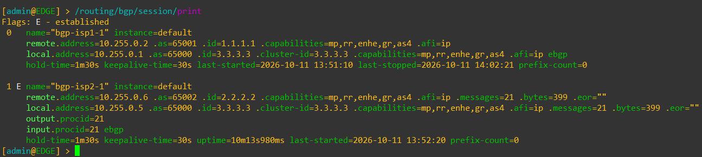
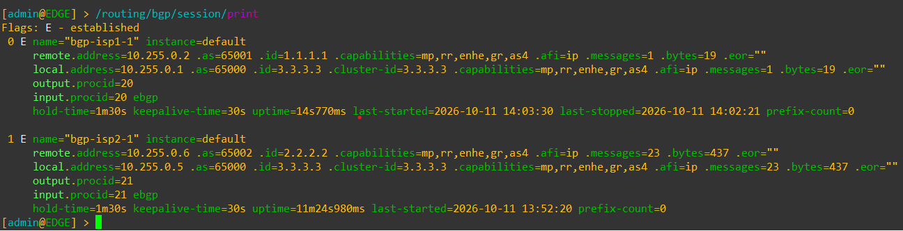

Ademas, tambien se configuro la opcion de anuncio de la ruta por defecto según los requisitos de la práctica, con el propósito de permitir que EDGE pudiera recibir una ruta por defecto desde los proveedores. La disponibilidad efectiva de esta ruta depende de la configuración aplicada y de la política de anuncios de cada ISP.

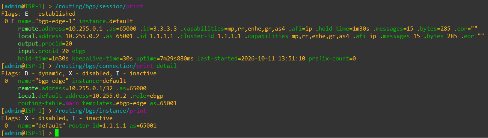
*Configuracion de eBGP en ISP-1*

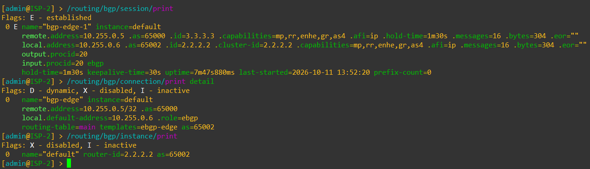
*Configuracion de eBGP en ISP-1*

#### 4.1.3 Verificación de las sesiones BGP
Una vez finalizada la configuración, se verificó el estado de las sesiones BGP en EDGE.
Lo cual se realizo a partir de ejecutar `/routing/bgp/session/print`, en donde se verifico que el estado Established sea indicado en la sesión BGP establecida y que los vecinos pueden intercambiar información de enrutamiento. Se verificó que tanto ISP-1 como ISP-2 alcanzaran dicho estado, de acuerdo con el criterio de aceptación definido para esta fase.

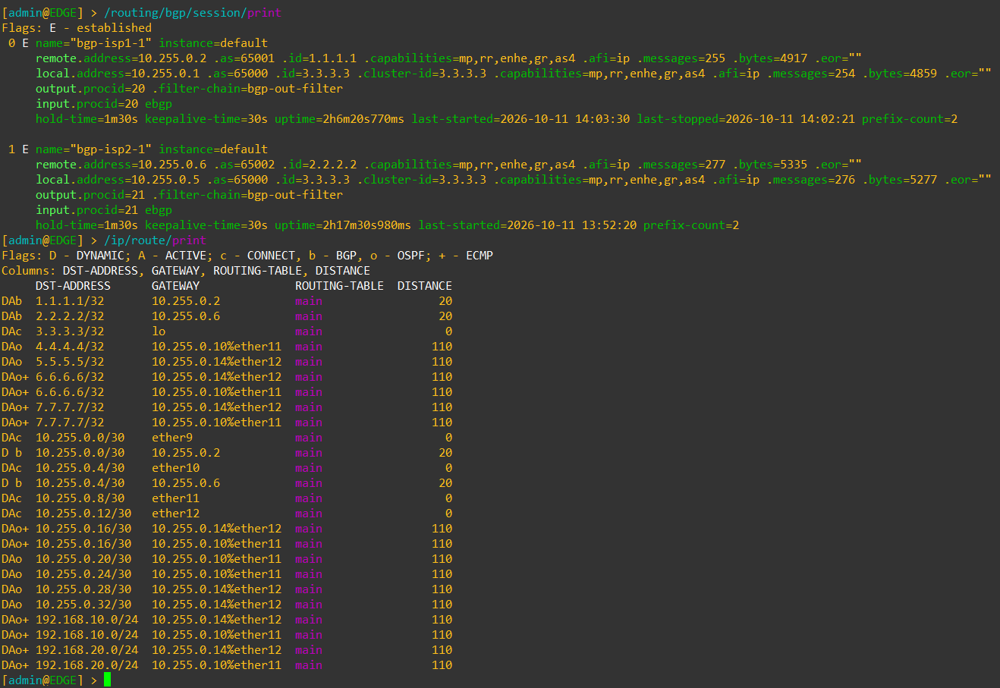

Comprobando asi que el estado de las sesiones con ambos proveedores.

### 4.2 Redistribución OSPF -> BGP en EDGE
Segun la configuracion de enrutamiento interno implementada en F2, se configuro en EDGE el mecanimso de redistribucion de rutas OSPF hacia BGP.

Con esta configuración se nos permite utilizar la información de enrutamiento interno para asi generar anuncios destinados a los vecinos BGP.

Cabe aclarar, que para evitar la publicación indiscriminada de rutas, se incorporaron filtros que delimitan los prefijos autorizados para su anuncio, ya que los filtros permiten determinar que redes internas se exponen al exterior y reducen el riesgo de anunciar rutas que no corresponden a la politica de enrutamiento.

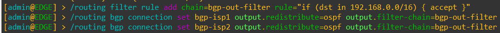


#### 4.2.1 Verificación de las LAN anunciadas en ISP-1 y ISP-2

Una vez configurada la redistribución, se consultó la tabla de rutas de ISP-1 y ISP-2 para comprobar la recepción de los prefijos internos anunciados por EDGE.

Ya con la verificación se centró en identificar las redes LAN previstas en el diseño y comprobar que fueran reconocidas como rutas BGP. De este forma, se evaluó el resultado de la redistribución desde la perspectiva del primer proveedor, en lugar de limitar la comprobación a la configuración local de EDGE.

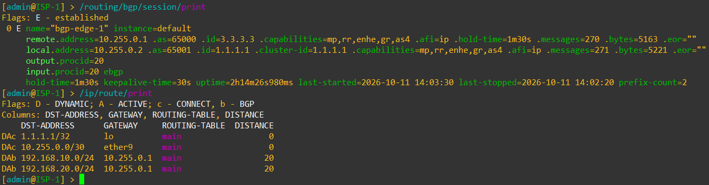

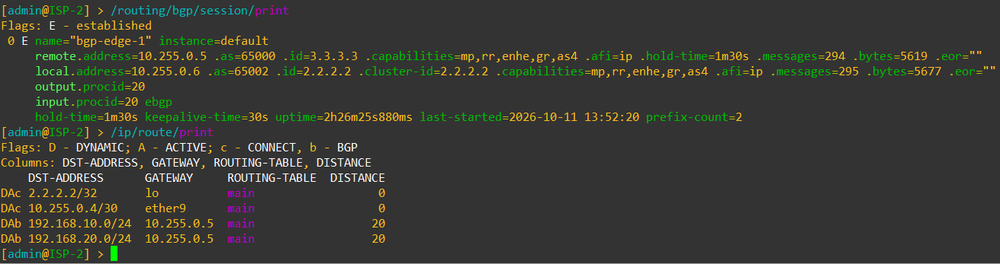

#### 4.2.2 Resultado de la fase

Con esta fase se implemento el mecanismo de redistribución de rutas OSPF hacia BGP en EDGE, con filtros para controlar los anuncios externos.

La verificación de las tablas de enrutamiento de ISP-1 e ISP-2 nos permitió evaluar si las LAN internas definidas por el laboratorio fueron propagadas correctamente mediante BGP. El criterio de aceptación se considera cumplido cuando los prefijos esperados aparecen en ambos proveedores como rutas BGP y las capturas aportan evidencia suficiente de su recepción.

De esta manera, la fase complementa la conectividad eBGP establecida en F3.1 y permite integrar el enrutamiento interno OSPF con el intercambio de rutas externo BGP.

## 6. Registro de cambios

### 6.1 Change log

Cada fila registra una intervención sobre los nodos con el formato definido en la sección 1.4: **fecha, rol, nodo, cambio, commit y rollback**. La columna *Commit* indica el commit del repositorio que versiona la configuración resultante (los `.rsc` de `backups/`). Los cambios se aplicaron en GNS3 y su estado queda respaldado en el commit citado.

**Rollback general:** cada fase tiene un backup completo de los 7 routers. Para volver a la fase anterior se restaura el `.rsc` correspondiente (`/system reset-configuration no-defaults=yes skip-backup=yes` y luego `/import file-name=<router>.rsc`), o se revierte al snapshot de GNS3 de esa fase. Se recuerda que `/export` no incluye claves: tras restaurar hay que volver a cargar las claves OSPF, BGP y VRRP (sección 1.3.4). Si el acceso por red se pierde, se opera por la consola de GNS3.

| Fase | Backup de partida (rollback) | Backup resultante |
|---|---|---|
| F2 | `backups/2026-10-08_F1_BASE/` | `backups/2026-10-11_F2_BASE/` |
| F3 | `backups/2026-10-11_F2_BASE/` | `backups/2026-10-11_F3_BASE/` |

#### 6.1.1 Fase 2: VRRP + OSPF

Los `.rsc` de F2 difieren de los de F1 solo en los routers que participan de VRRP y OSPF (EDGE, CORE-1, CORE-2, DIST-1 y DIST-2). ISP-1 e ISP-2 no cambiaron.

| Fecha | Rol | Nodo | Cambio | Commit | Rollback |
|---|---|---|---|---|---|
| 2026-10-11 | R4 | DIST-1 | VRRP v2 con auth simple: `vrrp-users` (vrid 10, prioridad 150, master) sobre `vlan10` y `vrrp-servers` (vrid 20, prioridad por defecto, backup) sobre `vlan20`. Gateways virtuales `192.168.10.1` y `192.168.20.1` | `e1f5757` | `/interface vrrp remove [find]` o restaurar `2026-10-08_F1_BASE/dist1.rsc` |
| 2026-10-11 | R4 | DIST-2 | VRRP v2 con auth simple: `vrrp-servers` (vrid 20, prioridad 150, master) y `vrrp-users` (vrid 10, prioridad por defecto, backup) | `e1f5757` | `/interface vrrp remove [find]` o restaurar `2026-10-08_F1_BASE/dist2.rsc` |
| 2026-10-11 | R3 | CORE-1 | OSPF área 0: instancia `ospf-instance-1` (router-id `4.4.4.4`), área `backbone-area` e interface-template en `ether9` a `ether12` y `lo`, con MD5 (`auth-id=1`) | `e1f5757` | Quitar el interface-template, el área y la instancia con `/routing ospf ... remove [find]` o restaurar `2026-10-08_F1_BASE/core1.rsc` |
| 2026-10-11 | R3 | CORE-2 | OSPF área 0 (router-id `5.5.5.5`) en `ether9` a `ether12` y `lo`, con MD5; incluye el enlace core–core | `e1f5757` | Igual que CORE-1; restaurar `2026-10-08_F1_BASE/core2.rsc` |
| 2026-10-11 | R4 | DIST-1 | OSPF área 0 (router-id `6.6.6.6`) en `ether9`, `ether10`, `vlan10`, `vlan20` y `lo`, con MD5 | `e1f5757` | Igual que CORE-1; restaurar `2026-10-08_F1_BASE/dist1.rsc` |
| 2026-10-11 | R4 | DIST-2 | OSPF área 0 (router-id `7.7.7.7`) en `ether9`, `ether10`, `vlan10`, `vlan20` y `lo`, con MD5 | `e1f5757` | Igual que CORE-1; restaurar `2026-10-08_F1_BASE/dist2.rsc` |
| 2026-10-11 | R1 | EDGE | OSPF área 0 (router-id `3.3.3.3`) hacia el core, en `ether11`, `ether12` y `lo`, con MD5 | `e1f5757` | Igual que CORE-1; restaurar `2026-10-08_F1_BASE/edge.rsc` |
| 2026-10-11 | R5 | Los 7 routers | Backup post-F2: `/export` de cada router versionado en `backups/2026-10-11_F2_BASE/`, con capturas de verificación en `capturas/F2/` | `e1f5757` | No aplica (el backup es la referencia de restauración) |
| 2026-10-13 | R5 | Documentación | Se documenta VRRP en la memoria (sección 3.1) | `0c4c1ef` | `git revert 0c4c1ef` |

#### 6.1.2 Fase 3: BGP + firewall

Entre F2 y F3 cambiaron EDGE, ISP-1 e ISP-2. CORE-1, CORE-2, DIST-1 y DIST-2 no tuvieron cambios de configuración (sus `.rsc` son iguales a los de F2).

| Fecha | Rol | Nodo | Cambio | Commit | Rollback |
|---|---|---|---|---|---|
| 2026-10-11 | R1 | EDGE | eBGP multi-homing: instancia BGP (AS `65000`, router-id `3.3.3.3`), template `ebgp-peers` y conexiones `bgp-isp1` (`10.255.0.2`, AS `65001`) y `bgp-isp2` (`10.255.0.6`, AS `65002`), con TCP-MD5 | `4cc7d15` | `/routing bgp connection remove [find]` o restaurar `2026-10-11_F2_BASE/edge.rsc` |
| 2026-10-11 | R2 | ISP-1 | eBGP hacia EDGE: instancia BGP (AS `65001`, router-id `1.1.1.1`), template `ebgp-edge` y conexión `bgp-edge` (`10.255.0.1`, AS `65000`) con TCP-MD5 y `output.redistribute=connected` | `4cc7d15` | `/routing bgp connection remove [find]` o restaurar `2026-10-11_F2_BASE/isp1.rsc` |
| 2026-10-11 | R2 | ISP-2 | eBGP hacia EDGE: instancia BGP (AS `65002`, router-id `2.2.2.2`) y conexión `bgp-edge` con TCP-MD5 y `output.redistribute=connected` | `4cc7d15` | `/routing bgp connection remove [find]` o restaurar `2026-10-11_F2_BASE/isp2.rsc` |
| 2026-10-11 | R1 | EDGE | Redistribución OSPF a BGP con filtro: `redistribute=ospf` y cadena de salida `bgp-out-filter`, que solo acepta prefijos dentro de `192.168.0.0/16` | `4cc7d15` | `/routing filter rule remove [find chain=bgp-out-filter]` y quitar `redistribute` de las conexiones, o restaurar `2026-10-11_F2_BASE/edge.rsc` |
| 2026-10-11 | R1 | EDGE | Salida a "Internet": la instancia OSPF pasa a `originate-default=always` para anunciar la ruta por defecto al dominio | `4cc7d15` | `/routing ospf instance set [find] originate-default=never` |
| 2026-10-11 | R1 | EDGE | Firewall: lista de interfaces `WAN` (`ether9`, `ether10`), reglas de `input` y `forward` (`established,related`, OSPF, ICMP, descarte desde WAN, descarte de inválidos), acceso SSH/Winbox solo desde interfaces fuera de `WAN` y NAT `masquerade` hacia ambos ISP | `4cc7d15` | `/ip firewall filter remove [find]` y `/ip firewall nat remove [find]`; hacerlo por consola de GNS3 si se pierde el acceso |
| 2026-10-14 | R5 | Los 7 routers | Backup post-F3: `/export` de cada router versionado en `backups/2026-10-11_F3_BASE/`, con capturas de verificación en `capturas/F3/` | `4cc7d15` | No aplica (el backup es la referencia de restauración) |

**Nota sobre las fechas:** los `.rsc` de F2 y F3 llevan fecha de exportación del 11/10 (el nombre de la carpeta de F3 también). El commit de F2 es del 11/10 y el de F3 del 14/10, por lo que las filas de F3 usan la fecha del export para el cambio y la del commit para el backup.

**Pendiente de registrar:** los cambios de F1 (despliegue, direccionamiento, hardening y backup inicial) no figuran todavía en este change log.
### 4.3 Salida a "Internet"

El objetivo de esta etapa es comprobar que los hosts de la red interna alcanzan el "Internet" simulado por el laboratorio, representado por las loopbacks de los proveedores (`1.1.1.1` en ISP-1 y `2.2.2.2` en ISP-2), y que la información de salida se propaga correctamente por el dominio OSPF.

#### 4.3.1 Ruta por defecto en EDGE y propagación por OSPF

Para que los routers internos sepan hacia dónde enviar el tráfico externo, EDGE origina una ruta por defecto dentro de OSPF. En la instancia OSPF de EDGE se configuró `originate-default=always`, por lo que la ruta `0.0.0.0/0` se anuncia al área 0 de forma permanente.

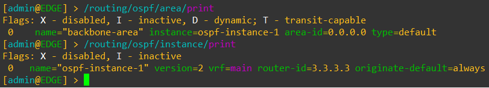

Se verificó la propagación en el resto de los routers con `/ip route print`:

| Router | Ruta `0.0.0.0/0` | Gateway | Distancia |
|---|---|---|---|
| CORE-1 | Aprendida por OSPF | `10.255.0.9` (EDGE, `ether9`) | `110` |
| DIST-1 | Aprendida por OSPF, 2 caminos (ECMP) | `10.255.0.21` (CORE-1, `ether9`) y `10.255.0.29` (CORE-2, `ether10`) | `110` |

CORE-1 llega a la salida directamente por EDGE, y DIST-1 reparte el tráfico entre ambos routers de core. Con esto la ruta por defecto queda disponible hasta la capa de distribución, y los hosts la alcanzan a través del gateway virtual VRRP.

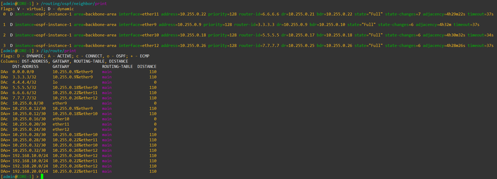

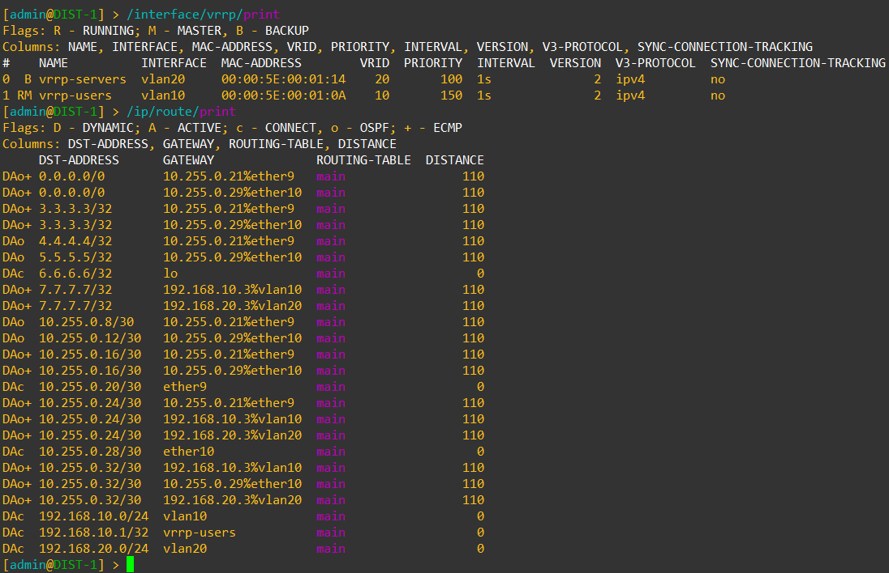

**Observación sobre la ruta recibida de los ISP:** en la tabla de ruteo de EDGE no figura una ruta `0.0.0.0/0` aprendida por BGP. Las sesiones con ISP-1 e ISP-2 están en estado `Established` y cada una intercambia 2 prefijos (la loopback del proveedor y el enlace), pero ninguno es una ruta por defecto. En EDGE, las rutas hacia los ISP son específicas: `1.1.1.1/32` vía `10.255.0.2` y `2.2.2.2/32` vía `10.255.0.6`, ambas con distancia `20` (eBGP). La default que ven los routers internos es, entonces, la que origina el propio EDGE en OSPF y no una recibida de los proveedores.


#### 4.3.2 Prueba de alcance a las loopbacks de los ISP

Desde PC-USER (`192.168.10.100`) se ejecutó `ping` a la loopback de cada proveedor:

| Origen | Destino | Resultado |
|---|---|---|
| PC-USER | `1.1.1.1` (ISP-1) | 3 enviados, 3 recibidos, 0 % de pérdida, TTL 61 |
| PC-USER | `2.2.2.2` (ISP-2) | 3 enviados, 3 recibidos, 0 % de pérdida, TTL 61 |

El TTL de 61 corresponde a tres saltos de router (DIST, CORE y EDGE) desde el valor inicial de 64, coherente con el camino `PC-USER → DIST → CORE → EDGE → ISP`.

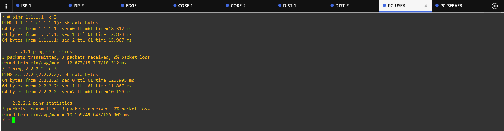

El camino de ida usa la default de OSPF hasta EDGE, y desde EDGE las rutas específicas de BGP hacia cada ISP. La respuesta vuelve porque los ISP conocen las LAN internas por la redistribución OSPF → BGP (sección 4.2) y porque EDGE aplica NAT `masquerade` en `ether9` y `ether10`.

#### 4.3.3 Resultado de la fase

El criterio de aceptación se cumple: un host de la red interna alcanza la loopback de ISP-1 y la de ISP-2. EDGE origina la ruta por defecto hacia el dominio OSPF y esta llega a CORE-1, CORE-2 y a la capa de distribución.

Queda como punto a tener en cuenta para la revisión que la salida funciona porque EDGE tiene rutas específicas hacia las loopbacks de los ISP y origina la default con `always`. La default no depende de que los ISP la anuncien por BGP, de modo que el alcance a destinos que no sean esas loopbacks no está probado en este laboratorio.


### 4.4 Firewall edge

El objetivo de esta etapa corresponde a proteger el router EDGE, que es el punto de contacto con los proveedores. Para ello se configuro un filtro de entrada en `/ip firewall filter` que acepta el trafico necesario para el funcionamiento de la red y bloquea el trafico no solicitado que llega desde los enlaces WAN (`ether9` hacia ISP-1 y `ether10` hacia ISP-2).

Antes de cargar las reglas se creo la lista de interfaces `WAN` con `ether9` y `ether10`, que se utiliza para identificar el trafico que proviene de los ISP.

#### 4.4.1 Reglas de la cadena input

La cadena `input` filtra el trafico dirigido al propio router EDGE.

| # | Acción | Condición | Función |
|---|---|---|---|
| 1 | accept | `connection-state=established,related` | Aceptar conexiones establecidas o relacionadas |
| 2 | accept | `protocol=ospf` | Permitir OSPF con CORE-1 y CORE-2 |
| 3 | accept | `protocol=icmp` | Permitir ping/ICMP de gestion |
| 4 | drop | `in-interface=ether9` | Bloquear trafico no deseado desde ISP-1 |
| 5 | drop | `in-interface=ether10` | Bloquear trafico no deseado desde ISP-2 |
| 6 | accept | `protocol=tcp dst-port=22,8291 in-interface-list=!WAN` | Permitir SSH/Winbox desde la red interna |

#### 4.4.2 Reglas de la cadena forward

La cadena `forward` filtra el trafico que atraviesa EDGE entre la red interna y los ISP.

| # | Acción | Condición | Función |
|---|---|---|---|
| 1 | accept | `connection-state=established,related` | Aceptar trafico establecido o relacionado |
| 2 | accept | `src-address=192.168.0.0/16` | Permitir la salida de las LAN hacia "Internet" |
| 3 | drop | `connection-state=invalid` | Descartar paquetes invalidos |
| 4 | drop | `in-interface=ether9 connection-nat-state=!dstnat` | Bloquear trafico entrante no solicitado desde ISP-1 |
| 5 | drop | `in-interface=ether10 connection-nat-state=!dstnat` | Bloquear trafico entrante no solicitado desde ISP-2 |

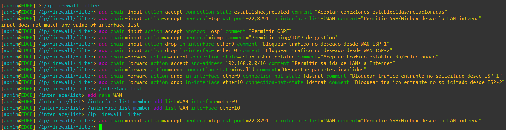
*Configuracion del firewall filter y de la lista WAN en EDGE*

#### 4.4.3 Protección del plano de gestión

El acceso de gestion a EDGE queda protegido desde los enlaces WAN: cualquier conexion nueva que llegue por `ether9` o `ether10` es descartada por las reglas 4 y 5 de la cadena `input`, incluidos SSH y Winbox. Desde la red interna se permite SSH (puerto 22) y Winbox (puerto 8291) mediante la regla 6.

Esto se complementa con el hardening aplicado en F1 (seccion 2.3), donde se deshabilitaron `ftp`, `telnet`, `www`, `www-ssl`, `api` y `api-ssl`, dejando solo `ssh` y `winbox` como servicios de gestion.

#### 4.4.4 Prueba de las reglas

Para comprobar el funcionamiento del firewall se verifico que las reglas esten cargadas y activas, y que el trafico permitido siga pasando por EDGE con el filtro aplicado.

| Prueba | Regla involucrada | Resultado | Evidencia |
|---|---|---|---|
| Reglas cargadas y activas | Cadenas `input` y `forward` | Las 12 reglas figuran en `/ip firewall filter print` sin la marca `X` (deshabilitada) | `estadoFinalEDGE_C.png` |
| NAT hacia los ISP | `srcnat masquerade` en `ether9` y `ether10` | Configurado en ambos enlaces WAN | `estadoFinalEDGE_C.png` |
| Salida de las LAN hacia "Internet" | `forward` regla 2 (`src-address=192.168.0.0/16`) | PC-USER alcanza `1.1.1.1` y `2.2.2.2` (0 % de pérdida) | `verificacionFinalPingueoALoopbacksDesdePC-USER.png` (sección 4.3.2) |
| Sesiones BGP con los ISP | `input` regla 1 (`established,related`) | Sesiones con ISP-1 e ISP-2 en estado `Established` | `estadoFinalEDGE_A.png` (sección 4.1.3) |
| Adyacencias OSPF de EDGE | `input` regla 2 (`protocol=ospf`) | Adyacencias con CORE-1 y CORE-2 operativas | Sección 3.2.3 |

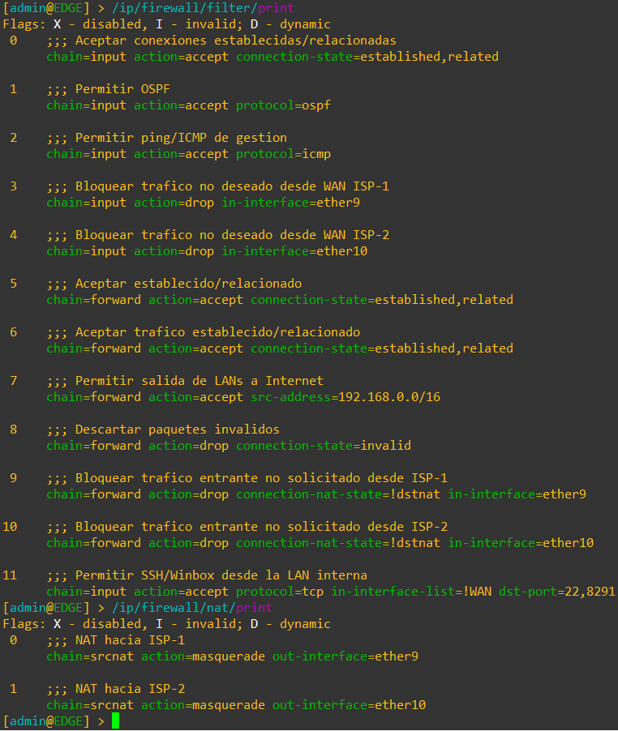
*Estado final de `/ip firewall filter` y `/ip firewall nat` en EDGE*

Con esto se comprueba que el filtro esta activo y no interrumpe el trafico necesario para la red.

#### 4.4.5 Resultado de la implementación

Con esta configuracion EDGE cuenta con un filtro de entrada que acepta el trafico establecido, OSPF e ICMP, y bloquea el trafico no solicitado desde ambos ISP, tanto hacia el router como a traves de el. La salida de las LAN hacia los proveedores sigue funcionando, como se comprobo en la seccion 4.3.

Observación para la revisión: la configuracion se tomo del respaldo `backups/2026-10-11_F3_BASE/edge.rsc` y de la captura. Hay algunos puntos a tener en cuenta:

- La cadena `input` no termina con una regla de drop general. El bloqueo aplica a lo que llega por las interfaces WAN, y lo que llega desde la red interna y no coincide con ninguna regla es aceptado por defecto. Por eso la regla 6 (SSH/Winbox) no restringe por si sola el acceso interno.
- En el respaldo, la regla `established,related` de la cadena `forward` aparece dos veces. No afecta el funcionamiento, pero se podria dejar una sola.
- No hay una regla explicita para BGP (TCP 179). Las sesiones con los ISP funcionan porque el trafico de respuesta entra como `established`, pero se podria agregar una regla de accept para BGP desde las IP de los vecinos si se quiere dejarlo explicito.
